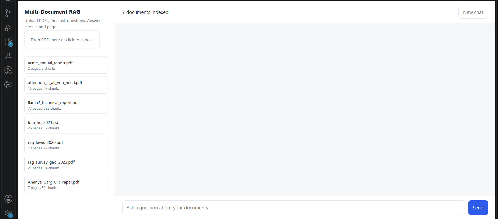

# Multi-Document RAG with Chat Memory

Assignment 3 (Generative AI) for the Machine Learning / GenAI Engineer role at Humanli.ai.



Upload PDFs, ask questions in plain language, and get answers grounded in the documents with the **file and page** they came from. When the answer is not in the documents, it says so. It remembers earlier turns, so follow-up questions work. Only open-source models are used (Qwen2.5 for answers, BGE for embeddings).

The notebook in [`notebooks/`](notebooks/) ("Assignment 3: Generative AI – Intelligent Multi-Document RAG System") is the verified run on a Kaggle T4 GPU, with all outputs saved. The `app/` folder is the same pipeline as a FastAPI service with a small web page.

## How it works

1. **Ingest:** clean the text, extract tables, split into 1000-character chunks (150 overlap), drop bibliography chunks.
2. **Retrieve:** FAISS (dense) + BM25 (keyword), merged with reciprocal rank fusion, then reranked with a cross-encoder. Comparison questions take the best chunks from each document.
3. **Answer:** the LLM sees only the numbered passages and cites them. The cited file and page are shown to the user.
4. **"Not found":** the question is refused if no passage scores high enough, if the LLM's confidence check (`p_yes`) is low, or if the model itself says so.
5. **Memory:** follow-up questions are rewritten into standalone questions. The last 4 turns are kept and older ones are summarised.

## Run it

```bash
python -m venv .venv
.venv\Scripts\Activate.ps1          # Mac/Linux: source .venv/bin/activate
pip install -r requirements.txt
python scripts/download_sample_docs.py
uvicorn app.main:app --port 8000
```

Open http://localhost:8000. The first start downloads the models (several GB) and indexes the PDFs in `data/pdfs/`.

To choose a smaller model, set it in the same terminal before starting the server:

```bash
$env:LLM_MODEL="Qwen/Qwen2.5-1.5B-Instruct"      # Mac/Linux: export LLM_MODEL=Qwen/Qwen2.5-1.5B-Instruct
```

The default is `Qwen/Qwen2.5-3B-Instruct` (used in the notebook). It needs a GPU or plenty of free RAM. `Qwen/Qwen2.5-0.5B-Instruct` is the smallest option and gives the weakest answers.

## API

| Method | Path | Purpose |
|---|---|---|
| POST | `/upload` | upload one or more PDFs (multipart field `files`) |
| GET | `/documents` | list indexed documents |
| POST | `/chat` | `{"question": "...", "session_id": "optional"}` returns the answer, sources and session id |
| POST | `/reset` | `{"session_id": "..."}` clears that conversation |

```bash
curl -X POST http://localhost:8000/chat -H "Content-Type: application/json" \
  -d '{"question": "How many attention heads does the base Transformer use?"}'
```

## Results

Kaggle T4 GPU, Qwen2.5-3B-Instruct, 20 questions in `eval/questions.json` (14 answerable, 6 not answerable, including 4 near-misses such as "How many parameters does GPT-4 have?"):

| Metric | Result |
|---|---|
| Answerable: cited the right document(s) | 14 / 14 |
| Answerable: answer contains the expected fact | 14 / 14 |
| Answerable: wrongly refused | 0 / 14 |
| Not answerable: correctly refused | 6 / 6 |

This is a small smoke test. The confidence threshold was chosen on the same 20 questions that are scored, so the numbers are optimistic. The full outputs are in the notebook.

## Verification status

- **Notebook run:** verified end to end on a Kaggle T4 GPU.
- **Tests:** `pytest` passes 18 tests (fake models, no downloads) on Windows with Python 3.11. Run `pip install -r requirements-dev.txt` and then `pytest`.
- **Local server:** on my low-memory Windows laptop it started, served the web page, and indexed all the PDFs, but loading the larger models and answering chat requests ran out of memory. Use a machine with a GPU or plenty of free RAM.
- **Not run locally:** `scripts/evaluate.py`.

## Dataset

Five public arXiv papers, downloaded by `scripts/download_sample_docs.py`: Attention Is All You Need (1706.03762), the original RAG paper (2005.11401), Llama 2 (2307.09288), a RAG survey (2312.10997) and LoRA (2106.09685). A small **synthetic** report, `acme_annual_report.pdf`, is generated by the script to test numbers and tables. The PDFs are not stored in this repository.

## Limitations

- No OCR, so scanned PDFs are not supported.
- Comparison questions skip the `p_yes` check, so an unanswerable comparison relies on the model refusing by itself.
- Duplicate uploads are detected by filename, not content.
- Chat sessions live in memory and are lost on restart.
- No authentication, no Docker setup and no document deletion yet.
