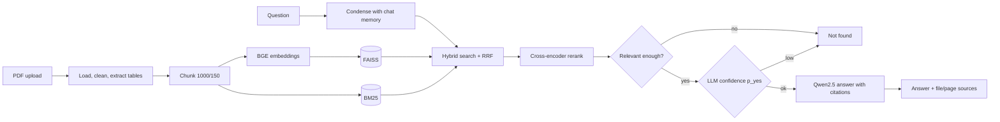

# Multi-Document RAG with Chat History and Conversational Memory

Assignment 3 (Generative AI) for the Machine Learning / GenAI Engineer role at Humanli.ai.


Upload several PDFs, ask questions in natural language, and get answers that are grounded in the documents, cite **file and page**, say so when the answer is not there, and remember the conversation for follow-up questions. Everything uses open-source models.

The notebook **"Assignment 3: Generative AI – Intelligent Multi-Document RAG System"** in the [`notebooks/`](notebooks/) folder is the verified end-to-end run (Kaggle T4 GPU) with all outputs saved. The `app/` folder is the same pipeline packaged as a FastAPI service.

## Features

- **Multi-PDF upload** through a REST API or the built-in web page, with incremental indexing and a saved index that survives restarts
- **Hybrid retrieval**: FAISS dense search (BGE embeddings) + BM25, fused with reciprocal rank fusion, then reranked with a cross-encoder
- **Grounded answers with citations**: every answer lists the source file and page that were actually cited
- **"Not found" handling** with three layers: a rerank-score threshold, an LLM confidence check (`p_yes`), and a strict prompt
- **Conversational memory**: follow-up questions are rewritten into standalone questions; older turns are folded into a rolling summary
- **Cross-document questions**: comparison questions retrieve from each named document so one paper cannot crowd out the other
- **Tables**: pdfplumber extracts table rows so numbers stay linked to their row and column headers
- Open-source LLM (Qwen2.5-Instruct), FastAPI service, unit and API tests, evaluation script

## Architecture



## Project structure

```
README.md
requirements.txt
requirements-dev.txt
app/
  config.py      settings (env overridable)
  ingest.py      PDF loading, cleaning, table extraction
  index.py       FAISS + BM25 + RRF + rerank, save/load
  models.py      embeddings, reranker, local LLM
  rag.py         prompts, memory, grounding, citations
  engine.py      shared index + per-session memory
  main.py        FastAPI endpoints
  static/        small chat UI
config/aliases.json   optional phrases that identify a document in a question
scripts/              download_sample_docs.py, make_sample_report.py, evaluate.py
eval/questions.json   20 evaluation questions
tests/                unit and API tests (run without downloading any model)
notebooks/            Kaggle notebook with the saved outputs of the verified run
docs/screenshot.png   screenshot used in this README
```

## Setup

Python 3.10+ is required. The LLM needs memory: a GPU (8 GB+) gives answers in a few seconds; on CPU use a small model and make sure the machine has enough free RAM (see Verification status).

```bash
python -m venv .venv
source .venv/bin/activate          # Windows PowerShell: .venv\Scripts\Activate.ps1
pip install -r requirements.txt

python scripts/download_sample_docs.py     # 5 arXiv papers + a small synthetic annual report
uvicorn app.main:app --port 8000
```

Open http://localhost:8000. The first start downloads the models (several GB) and indexes everything in `data/pdfs/`. Later starts load the saved index from `data/store/`.

Choose the LLM with an environment variable set in the same terminal, before starting the server:

```bash
export LLM_MODEL=Qwen/Qwen2.5-1.5B-Instruct      # Windows PowerShell: $env:LLM_MODEL="Qwen/Qwen2.5-1.5B-Instruct"
```

Options: `Qwen/Qwen2.5-3B-Instruct` (default, used in the verified notebook run), `Qwen/Qwen2.5-1.5B-Instruct`, `Qwen/Qwen2.5-0.5B-Instruct` (smallest, weakest answers).

## API

| Method | Path | Purpose |
|---|---|---|
| POST | `/upload` | upload one or more PDFs (multipart field `files`) |
| GET | `/documents` | list indexed documents |
| POST | `/chat` | `{"question": "...", "session_id": "optional"}` returns answer, sources, session id |
| POST | `/reset` | `{"session_id": "..."}` clears that conversation |
| GET | `/health` | status and index size |

```bash
curl -F "files=@report.pdf" -F "files=@manual.pdf" http://localhost:8000/upload

curl -X POST http://localhost:8000/chat -H "Content-Type: application/json" \
  -d '{"question": "How many attention heads does the base Transformer use?"}'
# {"session_id":"3f9c...","answer":"The base Transformer uses 8 parallel attention heads [1].",
#  "sources":[{"file":"attention_is_all_you_need.pdf","page":5}],"grounded":true,...}

# follow-up in the same conversation
curl -X POST http://localhost:8000/chat -H "Content-Type: application/json" \
  -d '{"question": "And how many layers does it have?", "session_id": "3f9c..."}'
```

Interactive docs are at http://localhost:8000/docs.

## How it works

**Ingestion.** Pages are cleaned (hyphenation, whitespace), tables are extracted separately so rows stay intact, text is split into 1000-character chunks with 150 overlap, and bibliography chunks are dropped. Each chunk is prefixed with its document title and keeps `source` and `page` metadata.

**Retrieval.** Dense (BGE) and sparse (BM25) results are merged with reciprocal rank fusion, and a cross-encoder reranks the top 20 candidates. Questions that name a document ("in the original RAG paper") are restricted to it; comparison questions take the best chunks from each document.

**Answering.** The LLM only sees the numbered passages and must cite them. Cited passages become the source list shown to the user.

**Unanswerable questions.** A question is refused when (1) no passage clears the rerank threshold, (2) the LLM's confidence that the passages answer the question (`p_yes`, read from the YES/NO token logits) is below `VERIFY_MIN` (not applied to comparison questions, whose answer spans several documents), or (3) the model itself replies with the not-found message. In the development run the rerank threshold alone was not enough: an unrelated question about Tesla's revenue still scored 1.2 on rerank and was stopped by the `p_yes` check.

**Memory.** The last 4 turns are kept verbatim. A follow-up containing a reference word ("it", "that", "them") is rewritten into a standalone question before retrieval; older turns are summarised. Citation markers are stripped before saving to memory because they point at passages from an earlier turn.

## Evaluation

20 questions (`eval/questions.json`): 14 answerable (5 papers, 1 cross-document comparison, 3 about a table-based report), 4 near-miss questions where the topic is in the documents but the answer is not (for example GPT-4 parameters, Meta's CEO), and 2 unrelated ones.

Results from the development run on a Kaggle T4 GPU (Qwen2.5-3B-Instruct). The full outputs are saved in the notebook in `notebooks/`:

| Metric | Result |
|---|---|
| Answerable: cited the right document(s) | 14 / 14 |
| Answerable: answer contains the expected fact | 14 / 14 |
| Answerable: wrongly refused | 0 / 14 |
| Unanswerable refused (incl. 4 near-miss) | 6 / 6 |
| Follow-up rewrite check | passed |
| Latency per question (demo questions) | about 3 to 9 s |

`p_yes` separated the two groups clearly: the lowest value for an answerable question was 0.04, the highest for an unanswerable one was below 1e-8, so `VERIFY_MIN=0.001` sits in a wide gap.

How to read these numbers: this is a small smoke test written by the author, not a benchmark. The threshold was chosen on the same 20 questions that are scored, so the results are optimistic, and the keyword check is deliberately simple (read the answers, not only the percentages). Held-out questions on unseen documents would be the next step. To regenerate the numbers on your own machine:

```bash
python scripts/evaluate.py      # writes eval/results.md
```

`scripts/evaluate.py` has not been run on a local machine yet.

## Verification status

- **Full pipeline (verified):** the Kaggle notebook ran end to end on a T4 GPU with Qwen2.5-3B, including retrieval, citations, follow-up questions, comparison questions, refusals and the evaluation above.
- **Tests (verified):** `pytest` passes 18 tests on Windows with Python 3.11. They use fake models, so no model downloads are needed.
- **Local server (partially verified):** on a Windows laptop with limited memory, the API started, served the web UI, and uploaded and indexed all six sample PDFs plus an extra PDF. Loading the 1.5B and 3B models, and answering chat requests with the 0.5B model, ran out of memory on that machine. Run the server on a machine with a GPU or plenty of free RAM.
- **Not tested:** the CPU `bfloat16` loading path in `app/models.py` on a real model.

## Tests

```bash
pip install -r requirements-dev.txt
pytest
```

The tests use fake embeddings, a fake reranker and a fake LLM, so they run in seconds without downloading models. They cover cleaning, table extraction, retrieval routing, persistence, citations, refusal logic, memory and every API endpoint.

## Configuration

Set these as environment variables in your shell (the app does not read `.env` files):

| Variable | Purpose |
|---|---|
| `LLM_MODEL` | Hugging Face model id of the LLM (default `Qwen/Qwen2.5-3B-Instruct`) |
| `LLM_DTYPE` | weight precision: `float16` on GPU and `bfloat16` on CPU by default; use `float32` if you have plenty of RAM |
| `EMBED_MODEL`, `RERANK_MODEL` | embedding and cross-encoder models |
| `RERANK_MIN_SCORE` | rerank threshold below which a passage is ignored |
| `VERIFY`, `VERIFY_MIN` | enable and tune the LLM confidence check |
| `TABLES` | extract tables with pdfplumber |
| `MAX_UPLOAD_MB`, `DATA_DIR` | upload size limit and data folder |

`config/aliases.json` is optional: it maps phrases to files so questions like "in the survey" are restricted to the right document. Documents without aliases still work through normal hybrid search.

## Dataset

Five public arXiv papers (downloaded by `scripts/download_sample_docs.py`):

| File | Source |
|---|---|
| attention_is_all_you_need.pdf | arXiv 1706.03762 |
| rag_lewis_2020.pdf | arXiv 2005.11401 |
| llama2_technical_report.pdf | arXiv 2307.09288 |
| rag_survey_gao_2023.pdf | arXiv 2312.10997 |
| lora_hu_2021.pdf | arXiv 2106.09685 |

`acme_annual_report.pdf` is a **synthetic** two-page report generated by `scripts/make_sample_report.py` to test numbers and tables, because the papers contain few tables. Any other PDF reports or manuals can be uploaded the same way. The PDFs themselves are not stored in this repository; the download script fetches them.

## Limitations and next steps

- Scanned PDFs (no text layer) are reported as unreadable; OCR is not included.
- Table extraction relies on pdfplumber and works best on ruled tables.
- Answer quality is bounded by the model size; a larger model or vLLM would improve fluency and speed.
- Comparison questions skip the `p_yes` confidence check, so an unanswerable comparison relies on the model refusing by itself. This case is not in the evaluation set yet.
- Answers contain `[n]` markers that refer to numbered passages; the UI shows file and page chips rather than mapping each marker.
- Duplicate uploads are detected by filename, not by content.
- Sessions are kept in memory (200 most recent) and are lost on restart; a Redis store would fix that.
- No authentication or per-user document isolation, no Docker setup yet, and document deletion is not implemented.